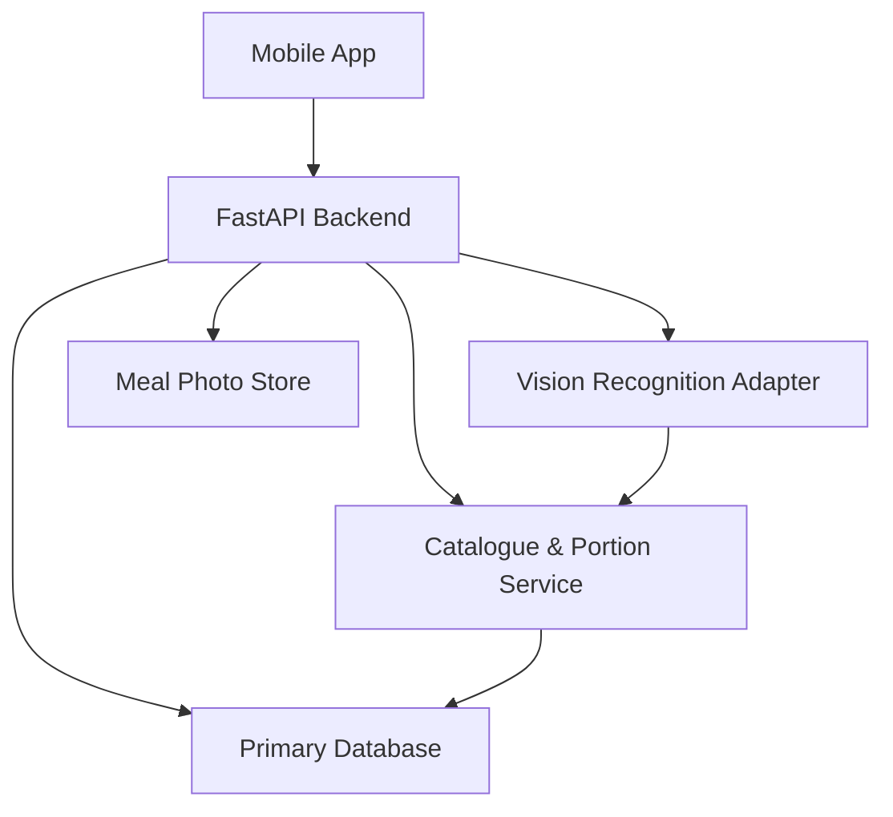
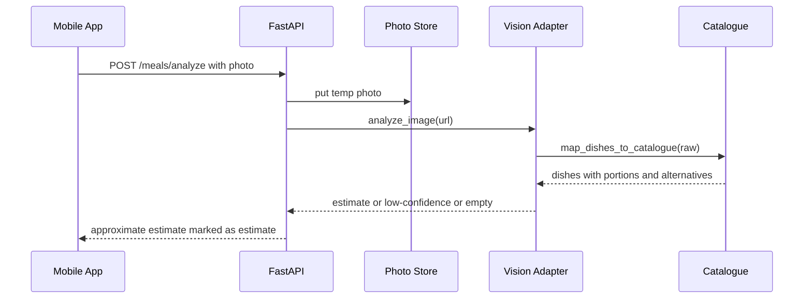
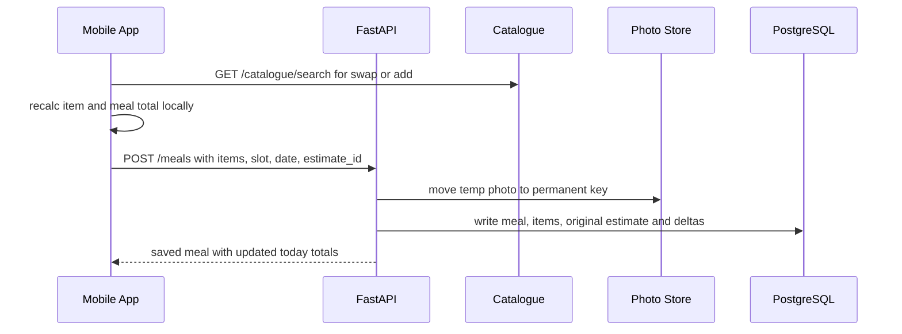
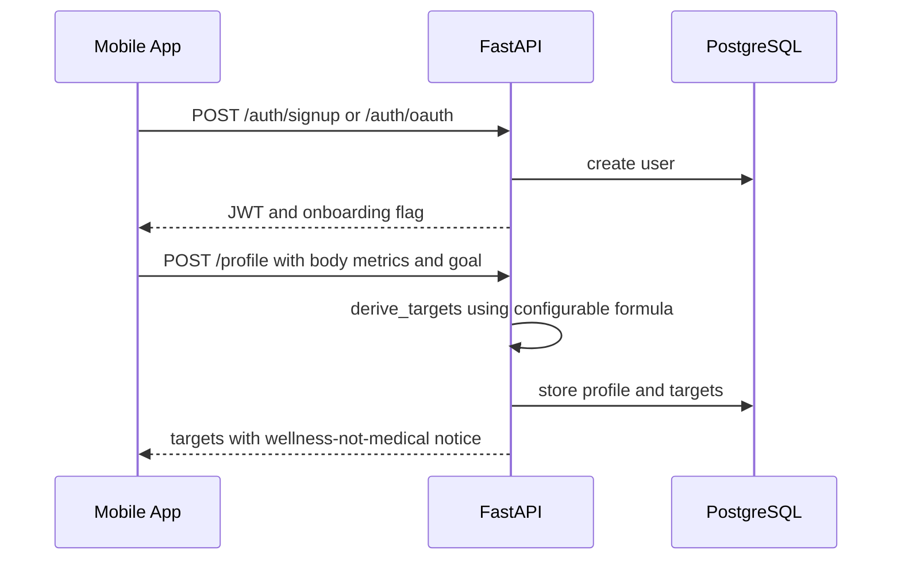
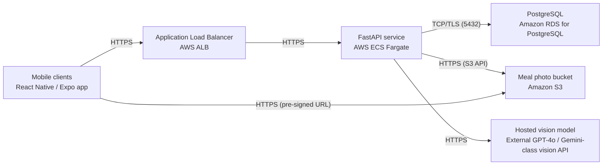

# Architecture

> Maintained by QuorQ AI SDLC. Text between `sdlc:auto` markers is regenerated; anything outside them is yours and is kept.

<!-- sdlc:auto:start narrative -->
## Overview

### ARCH-001 · approved · source: architecture

Approved v1 architecture: a single React Native (Expo) mobile app backed by a FastAPI service on AWS ECS Fargate (ap-south-1), RDS PostgreSQL, S3 photo storage, and a hosted third-party vision API, built to persist both the AI's original estimate and the user's correction for accuracy measurement.

Components: mobile_app (React Native/Expo, iOS+Android -- capture/gallery, estimate review/correction, daily log, history, weight log, onboarding/profile, permissions and offline/approximate-estimate framing); api (FastAPI on AWS ECS Fargate -- auth, profile/target derivation, meal save with correction capture, catalogue search, manual foods, weight log, photo-analysis orchestration, S3 lifecycle); catalogue_service (FastAPI module over Postgres full-text search -- curated food search, aliases, household portion units with gram equivalents, source/attribution metadata); vision_integration (Python httpx client to a hosted GPT-4o/Gemini-class API -- builds dish-identification prompts, parses dishes/portions/confidence, maps to catalogue entries and alternatives, handles timeouts/errors); photo_store (Amazon S3, ap-south-1 -- in-country photo storage, time-limited URLs to the owning account, deletion on meal delete/discard); db (Amazon RDS for PostgreSQL, ap-south-1 -- users, profiles, targets, catalogue, portion units, meals/items, original photo estimates, weight entries). Entities: users, user_profiles, user_targets, foods, food_aliases, portion_units, meals, meal_items, photo_estimates, weight_entries -- field-level schema as specified in the architecture input. Endpoints: POST/GET /auth and /profile family, POST /meals/analyze, GET /catalogue/search, POST /foods/manual, POST/GET/PUT/DELETE /meals, GET /home, POST/GET /weights -- each mapped 1:1 onto a user story's primary action. Deployment nodes: Mobile clients (Expo app) -> AWS Application Load Balancer -> FastAPI on ECS Fargate (Python 3.12, uvicorn/gunicorn) -> Amazon RDS for PostgreSQL and Amazon S3, both in ap-south-1, plus an external third-party hosted vision model. Technology decisions (all approved, alternatives considered and rejected): React Native/Expo over native Swift+Kotlin or Flutter; FastAPI over Node/NestJS or Django REST Framework; Amazon RDS for PostgreSQL over MySQL or MongoDB; AWS ap-south-1 over GCP Mumbai or Azure Central India; Amazon S3 over DB blobs or EFS for photo storage -- rationale for each matches the requirements-phase stack approval (REQ-000).

**Related:** EPIC-001, EPIC-002, EPIC-003, EPIC-004, EPIC-005, EPIC-006, EPIC-007, EPIC-008

### ARCH-002 · approved · source: architecture:critical_path:Photo analysis to estimate

Critical path for turning a camera/gallery photo into an approximate, correctable dish estimate.

User submits a camera or gallery photo via the mobile app; the API uploads it to S3, calls the vision_integration adapter against the hosted vision model, maps the result onto the catalogue_service with Indian portions and alternatives, and returns an approximate estimate to the client. Explicitly designed to handle no-food, low-confidence, offline, and vision-service-failure cases without ever blocking the user from logging by another path (search/manual).

**Related:** US-006, US-007, US-008, US-009, US-010

### ARCH-003 · approved · source: architecture:critical_path:Review, correct and save meal

Critical path for editing an estimate (swap dish, adjust portion, add/remove items), picking a slot/date, and saving, with both the AI estimate and the final correction persisted together.

The confirmed meal, its photo, and the original photo_estimates record are written together in the same save transaction so correction-vs-acceptance can be measured later without a separate analytics screen.

**Related:** US-011, US-012, US-013, US-014, US-016, US-031

### ARCH-004 · approved · source: architecture:critical_path:Onboarding to derived targets

Critical path from account creation (email/password or Google/Apple) through onboarding profile capture to a derived, configurable daily calorie/macro target shown as a general wellness estimate.

user_targets stores a formula_version and effective_from date specifically so the target calculation can change without an app release, matching AC-014's requirement that the (still-unagreed) formula be configurable.

**Related:** US-001, US-002, US-003, US-004, US-005, US-032
<!-- sdlc:auto:end narrative -->

<!-- sdlc:auto:start building-blocks -->
## Building Block View

| ID | Name | Technology | Responsibility | Depends on |
|---|---|---|---|---|
| mobile_app | Mobile App | React Native with Expo (iOS and Android) | Camera-first cross-platform UI: capture/gallery, estimate review and correction, daily log, history, weight log, onboarding and profile. Handles permissions, offline fallbacks and approximate-estimate framing. | api |
| api | FastAPI Backend | FastAPI (Python) on AWS ECS Fargate | Core REST API: auth, profile and target derivation, meal save with correction capture, catalogue search, manual foods, weight log, orchestration of photo analysis and S3 photo lifecycle. | db, photo_store, vision_integration, catalogue_service |
| catalogue_service | Catalogue & Portion Service | FastAPI module over PostgreSQL full-text search | In-process module serving curated food search (Postgres full-text), aliases, household portion units with gram equivalents, and source/attribution metadata. Shared by search and photo mapping. | db |
| vision_integration | Vision Recognition Adapter | Python httpx client to hosted GPT-4o / Gemini-class vision API | Builds the dish-identification prompt, calls the hosted multimodal vision model, parses dishes/portions/confidence, maps results onto catalogue entries and alternatives, and handles timeouts/errors. | catalogue_service |
| photo_store | Meal Photo Store | Amazon S3 (ap-south-1) | Stores meal photos in-country, serves them to the owning account via time-limited URLs, and deletes them when a meal is deleted or an estimate discarded. | — |
| db | Primary Database | Amazon RDS for PostgreSQL (ap-south-1) | Stores users, profiles, targets, catalogue, portion units, meals and items, original photo estimates for accuracy analysis, and weight entries. | — |

<!-- sdlc:auto:end building-blocks -->

<!-- sdlc:auto:start runtime -->
## Runtime View

### Photo analysis to estimate

User submits a camera or gallery photo, backend uploads it, calls the hosted vision model, maps dishes onto the catalogue with Indian portions and alternatives, and returns an approximate estimate. Handles no-food, low-confidence, offline and service-failure cases without blocking logging (US-006/007/008/009/010).

- **Components:** mobile_app, api, vision_integration, catalogue_service, photo_store, db
- **Modules:** capture_screen, analysis_orchestrator, vision_adapter, catalogue_mapper, photo_upload
- **Key functions:** submit_photo(user_id, image), upload_temp_photo(image), analyze_image(image_url), map_dishes_to_catalogue(raw_dishes), build_alternatives(dish), handle_failure(error)

### Review, correct and save meal

User edits the estimate (swap dish, adjust portion, add/remove items), picks a slot and date, and saves. The confirmed meal, its photo, and the original AI estimate are persisted together so correction vs acceptance can be measured (US-011..014, US-016, US-031).

- **Components:** mobile_app, api, catalogue_service, photo_store, db
- **Modules:** estimate_editor, portion_calculator, meal_writer, correction_recorder
- **Key functions:** recalc_item(food_id, quantity, unit), search_replacement(query), save_meal(user_id, slot, date, items, photo_ref, estimate_id), record_original_estimate(estimate, confirmed), persist_photo(temp_key, meal_id)

### Onboarding to derived targets

New user creates an account (email/password or Google/Apple), completes the profile, and the backend derives configurable daily calorie and macro targets shown as a general wellness estimate (US-001..005, US-032).

- **Components:** mobile_app, api, db
- **Modules:** auth_service, onboarding_flow, target_calculator
- **Key functions:** signup(email, password), oauth_signin(provider, token), save_profile(user_id, height, weight, age, activity, goal), derive_targets(profile, config), get_home_summary(user_id, date)

<!-- sdlc:auto:end runtime -->

<!-- sdlc:auto:start deployment-view -->
## Deployment View

| Name | Service | Runtime | Scaling | Environment |
|---|---|---|---|---|
| Mobile clients | React Native / Expo app | iOS and Android devices | Client-side, distributed via App Store and Play Store | dev |
| Application Load Balancer | AWS ALB | Managed | Managed, single AZ-group | dev |
| FastAPI service | AWS ECS Fargate | Python 3.12 container (uvicorn/gunicorn) | 1-2 tasks for ~1,000 beta users, horizontal if needed | dev |
| PostgreSQL | Amazon RDS for PostgreSQL | Managed PostgreSQL in ap-south-1 | Single instance (db.t3.small) with automated backups | dev |
| Meal photo bucket | Amazon S3 | Managed object storage in ap-south-1 | Elastic | dev |
| Hosted vision model | External GPT-4o / Gemini-class vision API | Third-party managed | Provider-managed, pay per request | dev |

| Source | Target | Protocol |
|---|---|---|
| Mobile clients | Application Load Balancer | HTTPS |
| Application Load Balancer | FastAPI service | HTTPS |
| FastAPI service | PostgreSQL | TCP/TLS (5432) |
| FastAPI service | Meal photo bucket | HTTPS (S3 API) |
| FastAPI service | Hosted vision model | HTTPS |
| Mobile clients | Meal photo bucket | HTTPS (pre-signed URL) |

<!-- sdlc:auto:end deployment-view -->

<!-- sdlc:auto:start decisions -->
## Architecture Decisions

| Layer | Choice | ADR |
|---|---|---|
| Frontend | React Native with Expo (iOS and Android) | [ADR-0001](adr/frontend.md) |
| Backend | FastAPI (Python) | [ADR-0002](adr/backend.md) |
| Database | Amazon RDS for PostgreSQL | [ADR-0003](adr/database.md) |
| Cloud | AWS (ap-south-1, Mumbai) | [ADR-0004](adr/cloud.md) |
| Backend | Amazon S3 (object store) for meal photos | [ADR-0005](adr/backend-2.md) |
<!-- sdlc:auto:end decisions -->

<!-- sdlc:auto:start links -->
## Related Documents

- [Data Model](data-model.md)
- [API Specification](api/openapi.yaml)
- [Architecture Decision Records](adr/README.md)
<!-- sdlc:auto:end links -->
