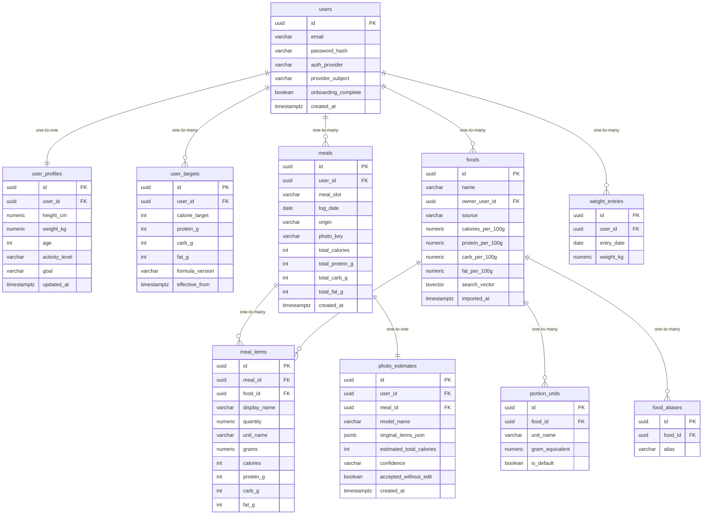

# Data Model

<!-- sdlc:auto:start entities -->
### users

| Field | Type | PK | FK | Nullable |
|---|---|---|---|---|
| id | uuid | True | — | False |
| email | varchar | False | — | True |
| password_hash | varchar | False | — | True |
| auth_provider | varchar | False | — | False |
| provider_subject | varchar | False | — | True |
| onboarding_complete | boolean | False | — | False |
| created_at | timestamptz | False | — | False |

### user_profiles

| Field | Type | PK | FK | Nullable |
|---|---|---|---|---|
| id | uuid | True | — | False |
| user_id | uuid | False | users.id | False |
| height_cm | numeric | False | — | False |
| weight_kg | numeric | False | — | False |
| age | int | False | — | False |
| activity_level | varchar | False | — | False |
| goal | varchar | False | — | False |
| updated_at | timestamptz | False | — | False |

### user_targets

| Field | Type | PK | FK | Nullable |
|---|---|---|---|---|
| id | uuid | True | — | False |
| user_id | uuid | False | users.id | False |
| calorie_target | int | False | — | False |
| protein_g | int | False | — | False |
| carb_g | int | False | — | False |
| fat_g | int | False | — | False |
| formula_version | varchar | False | — | False |
| effective_from | timestamptz | False | — | False |

### foods

| Field | Type | PK | FK | Nullable |
|---|---|---|---|---|
| id | uuid | True | — | False |
| name | varchar | False | — | False |
| owner_user_id | uuid | False | users.id | True |
| source | varchar | False | — | False |
| calories_per_100g | numeric | False | — | False |
| protein_per_100g | numeric | False | — | False |
| carb_per_100g | numeric | False | — | False |
| fat_per_100g | numeric | False | — | False |
| search_vector | tsvector | False | — | True |
| imported_at | timestamptz | False | — | True |

### food_aliases

| Field | Type | PK | FK | Nullable |
|---|---|---|---|---|
| id | uuid | True | — | False |
| food_id | uuid | False | foods.id | False |
| alias | varchar | False | — | False |

### portion_units

| Field | Type | PK | FK | Nullable |
|---|---|---|---|---|
| id | uuid | True | — | False |
| food_id | uuid | False | foods.id | False |
| unit_name | varchar | False | — | False |
| gram_equivalent | numeric | False | — | False |
| is_default | boolean | False | — | False |

### meals

| Field | Type | PK | FK | Nullable |
|---|---|---|---|---|
| id | uuid | True | — | False |
| user_id | uuid | False | users.id | False |
| meal_slot | varchar | False | — | False |
| log_date | date | False | — | False |
| origin | varchar | False | — | False |
| photo_key | varchar | False | — | True |
| total_calories | int | False | — | False |
| total_protein_g | int | False | — | False |
| total_carb_g | int | False | — | False |
| total_fat_g | int | False | — | False |
| created_at | timestamptz | False | — | False |

### meal_items

| Field | Type | PK | FK | Nullable |
|---|---|---|---|---|
| id | uuid | True | — | False |
| meal_id | uuid | False | meals.id | False |
| food_id | uuid | False | foods.id | True |
| display_name | varchar | False | — | False |
| quantity | numeric | False | — | False |
| unit_name | varchar | False | — | False |
| grams | numeric | False | — | False |
| calories | int | False | — | False |
| protein_g | int | False | — | False |
| carb_g | int | False | — | False |
| fat_g | int | False | — | False |

### photo_estimates

| Field | Type | PK | FK | Nullable |
|---|---|---|---|---|
| id | uuid | True | — | False |
| user_id | uuid | False | users.id | False |
| meal_id | uuid | False | meals.id | True |
| model_name | varchar | False | — | False |
| original_items_json | jsonb | False | — | False |
| estimated_total_calories | int | False | — | False |
| confidence | varchar | False | — | True |
| accepted_without_edit | boolean | False | — | False |
| created_at | timestamptz | False | — | False |

### weight_entries

| Field | Type | PK | FK | Nullable |
|---|---|---|---|---|
| id | uuid | True | — | False |
| user_id | uuid | False | users.id | False |
| entry_date | date | False | — | False |
| weight_kg | numeric | False | — | False |
<!-- sdlc:auto:end entities -->

<!-- sdlc:auto:start relationships -->
| Source | Target | Type |
|---|---|---|
| users | user_profiles | one-to-one |
| users | user_targets | one-to-many |
| users | meals | one-to-many |
| users | weight_entries | one-to-many |
| users | foods | one-to-many |
| meals | meal_items | one-to-many |
| foods | portion_units | one-to-many |
| foods | food_aliases | one-to-many |
| foods | meal_items | one-to-many |
| meals | photo_estimates | one-to-one |
<!-- sdlc:auto:end relationships -->

<!-- sdlc:auto:start er-diagram -->

<!-- sdlc:auto:end er-diagram -->
