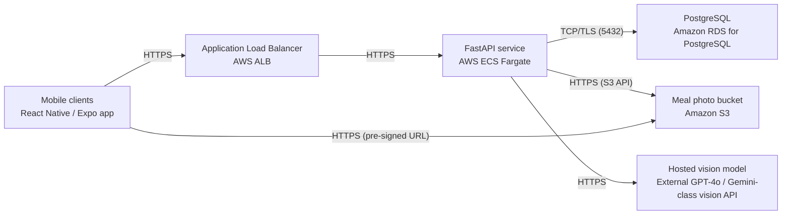

# Deployment Guide

> Maintained by QuorQ AI SDLC. Text between `sdlc:auto` markers is regenerated; anything outside them is yours and is kept.

<!-- sdlc:auto:start how-it-deploys -->
Pushes to `main` run `.github/workflows/deploy.yml`, which builds the API image (if there is a backend) and deploys the SPA to AWS Amplify. Commits touching only `docs/sdlc/**` don't deploy. Deployments can also be started from the platform's Deployment tab.
<!-- sdlc:auto:end how-it-deploys -->

<!-- sdlc:auto:start environments -->
| Name | Service | Runtime | Scaling | Environment |
|---|---|---|---|---|
| Mobile clients | React Native / Expo app | iOS and Android devices | Client-side, distributed via App Store and Play Store | dev |
| Application Load Balancer | AWS ALB | Managed | Managed, single AZ-group | dev |
| FastAPI service | AWS ECS Fargate | Python 3.12 container (uvicorn/gunicorn) | 1-2 tasks for ~1,000 beta users, horizontal if needed | dev |
| PostgreSQL | Amazon RDS for PostgreSQL | Managed PostgreSQL in ap-south-1 | Single instance (db.t3.small) with automated backups | dev |
| Meal photo bucket | Amazon S3 | Managed object storage in ap-south-1 | Elastic | dev |
| Hosted vision model | External GPT-4o / Gemini-class vision API | Third-party managed | Provider-managed, pay per request | dev |
<!-- sdlc:auto:end environments -->

<!-- sdlc:auto:start live -->
_Not deployed yet._
<!-- sdlc:auto:end live -->

<!-- sdlc:auto:start topology -->

<!-- sdlc:auto:end topology -->
